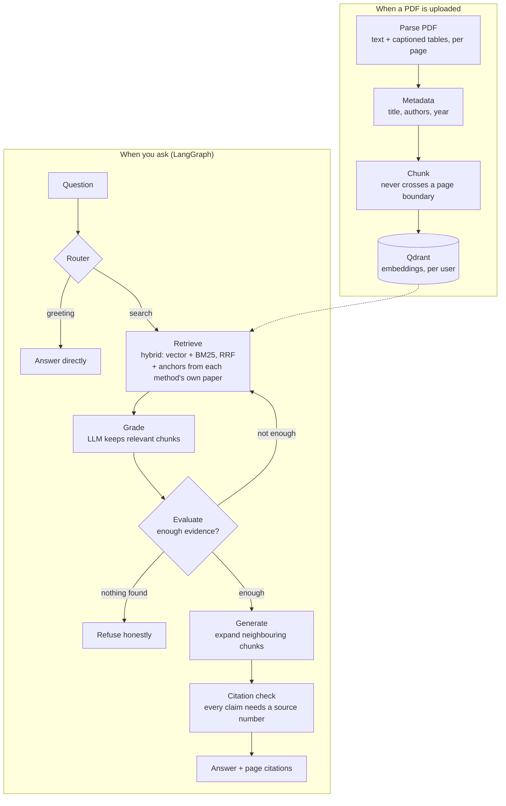

# Research & Thesis Assistant: Agentic RAG with page-level citations

Ask questions about **your own collection of journal PDFs** and get answers grounded only in those
papers, with a citation down to the **page number** for every sentence. If the answer is not in your
papers, the assistant says so instead of making something up.

> 🇮🇩 **Ringkasan:** Asisten riset & skripsi berbasis *agentic RAG*. Unggah jurnal PDF, ajukan
> pertanyaan, dan dapatkan jawaban yang hanya bersumber dari jurnalmu, dengan sitasi sampai nomor
> halaman. Mendukung jurnal berbahasa Indonesia dan Inggris. Skor evaluasi 15 soal: **98–100%**.


## Why

Students writing a thesis collect dozens of papers, then lose track of which paper said what, and
on which page. General chatbots answer fluently but can invent numbers, findings and even
references. This assistant is built for the opposite: **every claim is traceable** to a page you can
open and check.

## Results

Measured with a fixed set of 15 questions (`eval/questions.jsonl`) over 11 papers (6 English arXiv
papers on RAG, 5 Indonesian journals): comparisons between papers, specific numbers, lists that
live in tables, cross-language questions (ask in English, answer from an Indonesian journal),
greetings, and questions whose answer is **not** in the collection.

| Version | Score |
|---|---|
| First agent version | 48/56 (86%) |
| + table extraction, list-question table search | 53/56 (94.6%) |
| + entity anchors, comparison outline, model fallbacks | 56/56 and 55/56 (avg **99.1%**) |
| Latest (+ reference-list filtering, list checklist) | 55/56 (**98.2%**) |

**On papers the system was never tuned for:** 18/18 correct answers on 4 newly added papers
(*Attention Is All You Need*, two Indonesian sentiment-analysis papers, one education paper),
including numbers read from tables, cross-paper comparisons, and honest refusals.

Scores improved only by changing the system, never by loosening the answer key.

## How it works



Things worth noting, each added because a test failed without it:

- **Page-accurate chunks.** Chunks never span two pages, so a citation always points to one page.
- **Tables are read.** Tables with a "Table N" caption are extracted as their own chunks, so
  "list the four reflection tokens" is answered from the table, not guessed.
- **Hybrid retrieval, written from scratch.** Dense vectors catch meaning; BM25 catches exact terms
  like `ISREL` or `BM25`. Results are fused with Reciprocal Rank Fusion, and the top BM25 hit of
  each query is always kept, because RRF tends to favour generic intro paragraphs.
- **Entity anchors.** For "Self-RAG vs CRAG", the agent finds each method's *own* paper and pulls
  its method section, instead of relying on another paper's one-line summary of it.
- **Reference lists are excluded.** Bibliography pages mention every keyword but explain nothing.
- **Self-correcting loop.** If evidence is insufficient, the agent rewrites the query and searches
  again once; if still nothing, it refuses instead of answering from general knowledge.
- **Deterministic citation check.** At least 70% of claim sentences must carry `[n]`; otherwise the
  answer is regenerated once. Refusals carry no citations.
- **Free-tier friendly.** One gateway (`litellm`) with an ordered fallback chain. Per-minute limits
  wait and retry the same model; a model whose daily quota is exhausted is skipped.

## Tech stack

| Layer | Tools |
|---|---|
| UI | Streamlit |
| API | FastAPI, Uvicorn |
| Agent orchestration | LangGraph |
| LLM | gpt-oss-120b / gpt-oss-20b via Groq; fallbacks: Cloudflare Workers AI, Gemini, NVIDIA NIM (via litellm) |
| Retrieval | Hybrid search, BM25, RRF, entity anchors (custom) |
| Embeddings | sentence-transformers, `intfloat/multilingual-e5-small` (runs locally) |
| Vector DB | Qdrant (Docker) |
| PDF parsing | PyMuPDF, custom page-aware chunker and table extractor |
| Evaluation | Custom 15-question harness with keyword, source and refusal checks |

 

## Quick start

Requirements: Python 3.11+, Docker Desktop, a free [Groq API key](https://console.groq.com/keys).

```bash
python -m venv .venv
.venv\Scripts\activate            # macOS/Linux: source .venv/bin/activate
pip install -r requirements.txt

copy .env.example .env            # macOS/Linux: cp .env.example .env
# fill in GROQ_API_KEY; CLOUDFLARE_*, GEMINI_API_KEY, NVIDIA_API_KEY are optional fallbacks

docker compose up -d              # Qdrant on http://localhost:6333
streamlit run streamlit_app.py    # UI on http://localhost:8501
```

Upload PDFs in the sidebar, then ask. Toggle **"Tampilkan jejak agen"** to see each agent step.
The embedding model (~470 MB) downloads on first run.

### Command line

```bash
python -m scripts.ingest data/papers --user muhammad              # ingest a folder of PDFs
python -m scripts.tanya_agen "What is the difference between Self-RAG and CRAG?" --user muhammad --detail
python -m eval.run_eval --user muhammad --ulang 2 --jeda 10       # run the evaluation twice
uvicorn app.main:app --reload                                     # API docs at /docs
```

## Project structure

```
app/
  llm.py              single gateway to all LLMs, ordered fallbacks, quota handling
  query.py            multi-query: EN/ID variants and sub-questions
  agent/              LangGraph state, prompts, nodes, graph
  ingestion/          PDF parsing, tables, metadata, chunking, BM25, Qdrant indexing & hybrid search
  main.py             FastAPI: /upload, /chat
streamlit_app.py      UI
eval/                 questions.jsonl + run_eval.py
scripts/              CLI tools: ingest, ask, diagnostics
CHANGELOG.md          every change, with the failing test that motivated it
```

## Limitations

- Scanned PDFs are not supported yet (no OCR).
- Metadata (title, authors, year) is extracted automatically and is sometimes wrong.
- Free-tier LLM quotas limit how many questions can be asked per day.
- It speeds up finding and understanding sources; it does not replace reading them. Always open
  the cited page before quoting it in a thesis.

## Roadmap

- Edit metadata from the UI
- OCR for scanned PDFs
- LLM-based check that each citation actually supports its sentence
